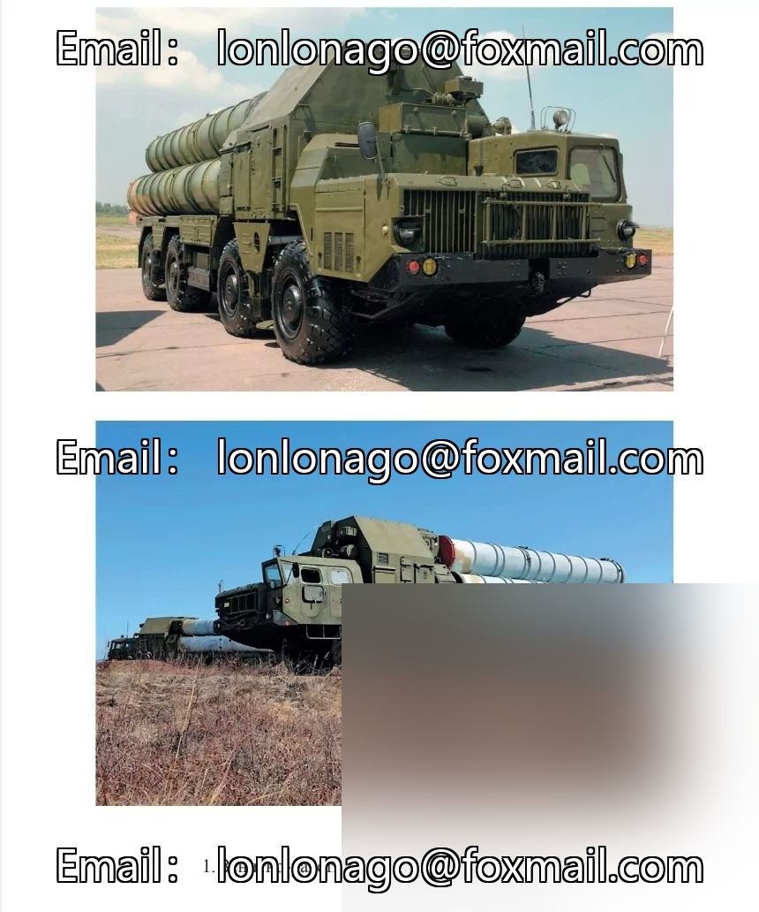
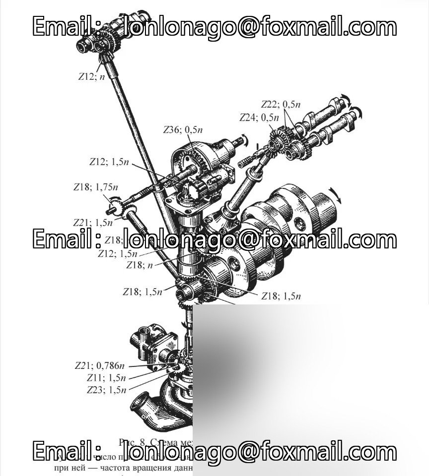
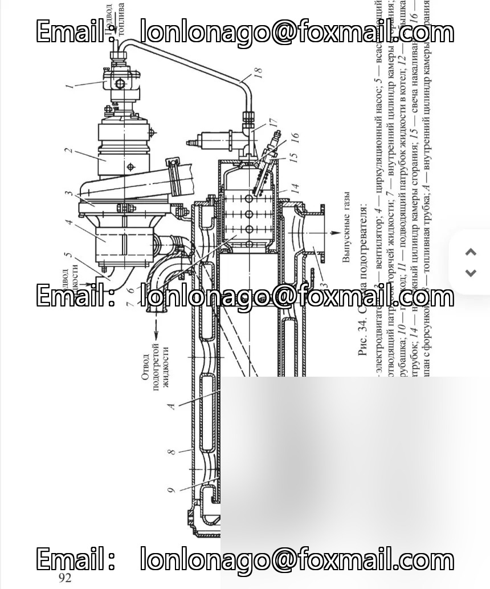
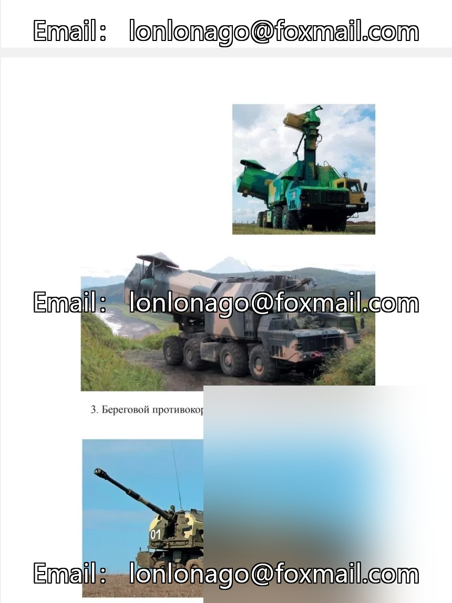

# MAZ-543 military chassis documentation package

## Body

MAZ-543 Military chassis data package MAZ-543 is a classic product of Mecani-Zhizkine (MAZ), its most famous identity being the transport-launcher-tower (TEL) chassis for the Scud tactical ballistic missile and other heavy rocket artillery of the Soviet/Russian side. Its variants (such as MAZ-543M, etc.) are widely equipped by military forces of multiple countries.
23725
(MAZ-543 wheeled chassis main parts, assemblies, and variants) document
PDF file 196

The MAZ-543 military chassis package features Maz's classic product, the Soviet/Russian "Scud" tactical ballistic missile and other heavy rocket-gun transport, hoist-and-launch vehicle (TEL) chassis, with main components, assemblies and variant materials, plus a PDF file and numbering information.

<!-- AI_ENRICHED -->

## Images

## Payment

Here is a pay link on Stripe ( https://buy.stripe.com/3cs8yP7sY87d0vu9AB ). Please contact me lonlonago@foxmail.com after funding $89, and I will send you a complete data files , thank you!

